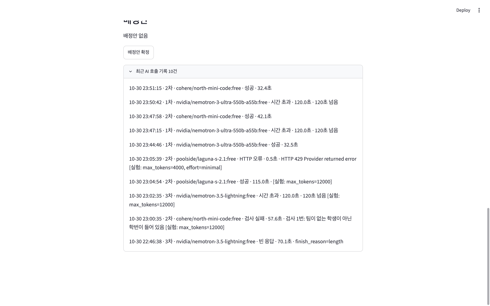
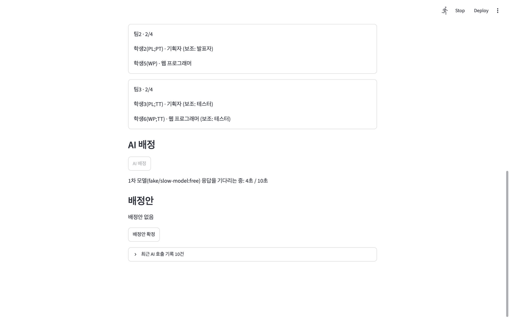
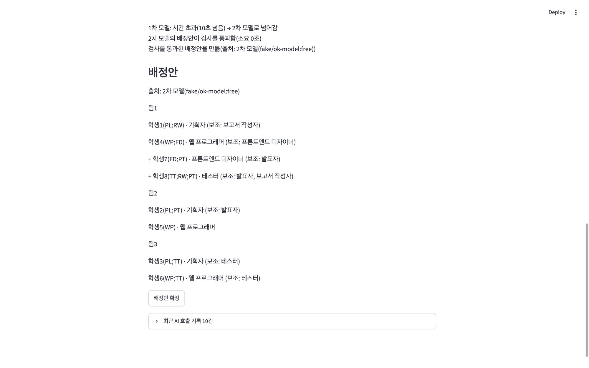
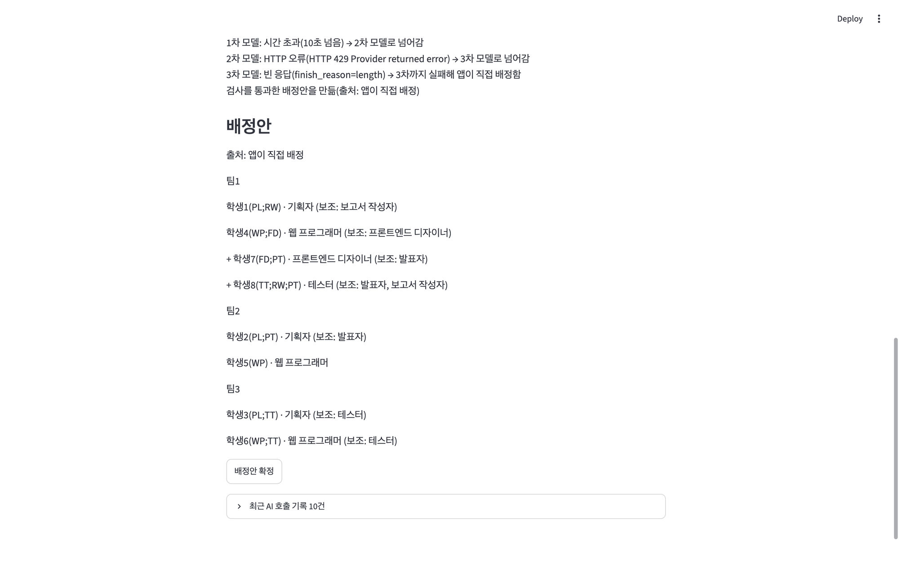
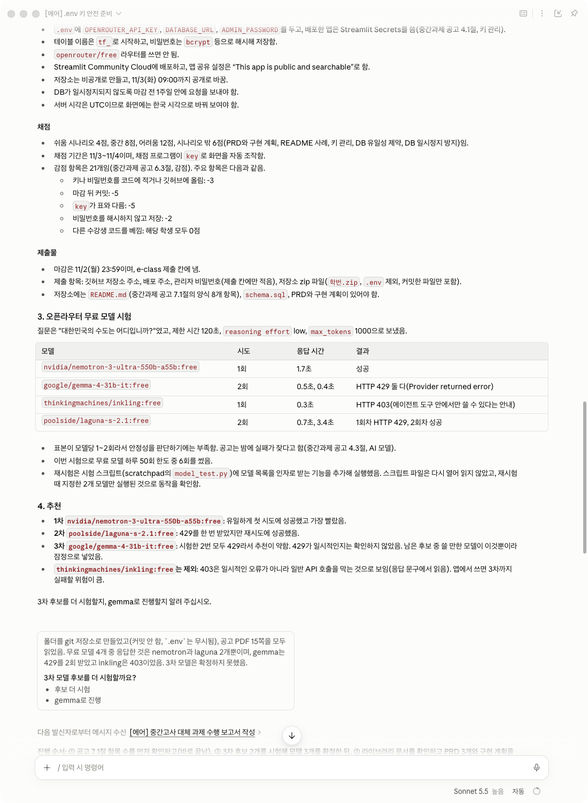
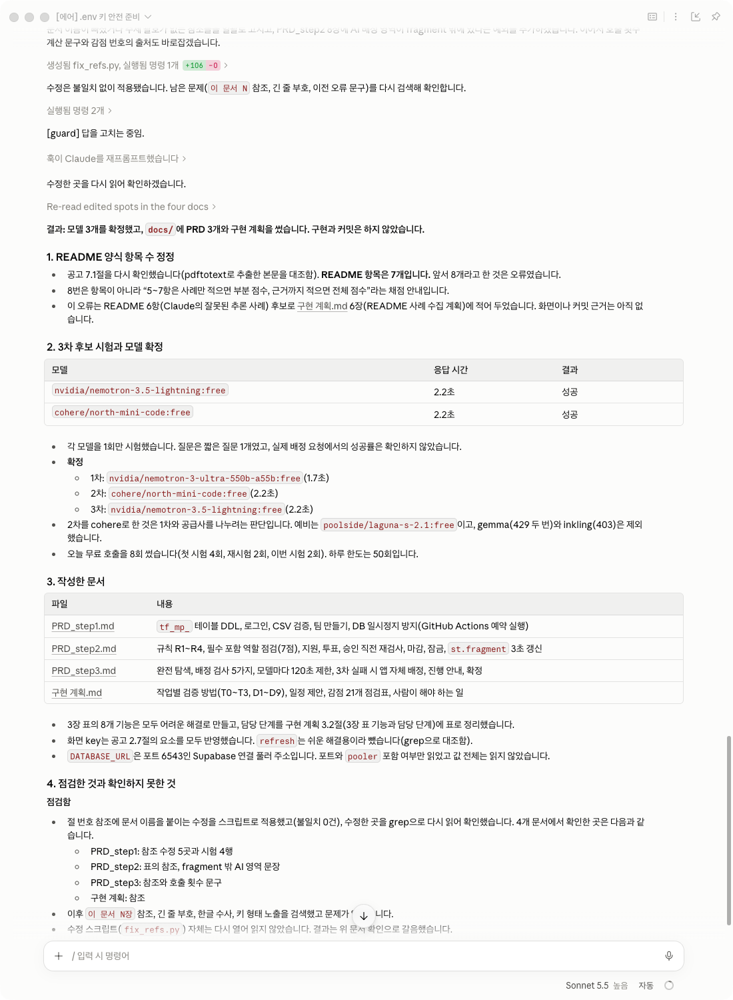
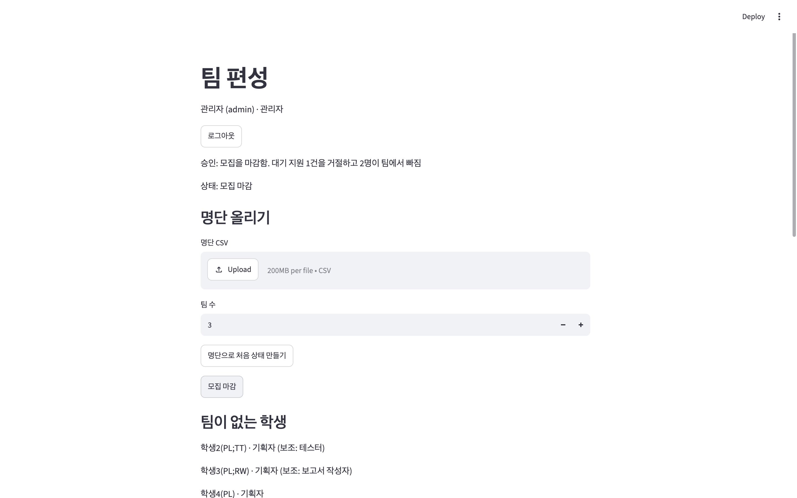

<!-- 2026-10-31 00:30 KST -->
# 팀 프로젝트 팀 편성 웹 앱

- 작성자: logistex
- 하는 일: 관리자가 가상 명단(CSV)을 올려 팀을 만들고, 학생이 팀에 지원하고 팀원이 투표하며, 모집을 마감한 뒤 남은 학생을 AI가 배정하고 앱이 검사해 관리자가 확정함(중간과제 공고 2절)
- 만든 것: Streamlit 앱, Supabase(Postgres) DB, OpenRouter 무료 모델
- 이 문서는 중간과제 공고 7.1절(README.md 양식)의 7개 항목 순서로 씀. README.md의 5항, 6항, 7항은 사례마다 근거(화면, 커밋, 시나리오 단계)를 붙였음

## 1. 배포 주소

https://prj-mid-26.streamlit.app

<!-- 배포 전에 쓴 주소임. 배포한 뒤 이 주소가 열리는지 확인하고 이 주석을 지울 것 -->

## 2. PRD와 구현 계획의 위치

PRD는 3단계로 나눠 썼음.

| 문서 | 내용 |
|---|---|
| [docs/PRD_step1.md](docs/PRD_step1.md) | 1단계: DB 테이블(`tf_mp_`), 로그인, 명단 올리기와 팀 만들기, DB 일시정지 방지 |
| [docs/PRD_step2.md](docs/PRD_step2.md) | 2단계: 지원, 투표, 모집 마감, 팀 규칙, 다른 사람의 변경 보기 |
| [docs/PRD_step3.md](docs/PRD_step3.md) | 3단계: AI 배정, 배정안 검사, 확정, 실패 처리 |
| [docs/구현 계획.md](docs/구현%20계획.md) | 작업 순서와 검증 방법, 감점 점검표 |
| [docs/보안 점검.md](docs/보안%20점검.md) | 배포 전 보안 진단 15개 항목(진단만 하고 고치지 않음) |

그 밖의 구성은 다음과 같음.

- `streamlit_app.py`: 화면. `mp/`: 규칙, DB, 서비스, AI 호출 코드
- `schema.sql`: `tf_mp_` 테이블과 제약. `tests/`: 시험과 연습용 CSV(`tests/data/`)
- `.env.example`: 값 없는 견본. 키와 관리자 비밀번호는 `.env`나 Streamlit Secrets에만 두고 저장소에는 없음

## 3. 고른 해결 방법

중간과제 공고 3장 표의 8개 기능을 모두 어려운 해결로 만들었음.

| 기능 | 고른 해결 | 한 일 | 확인한 것 |
|---|---|---|---|
| 다른 사람의 변경 보기 | 어려운 해결 | 본문을 `st.fragment(run_every="3s")`로 3초마다 바뀐 부분만 다시 그림. `refresh` 단추는 두지 않음 | 아무것도 누르지 않은 학생 화면에 다른 학생의 지원과 승인이 자동으로 나타남(로컬 브라우저) |
| 필수 포함 역할을 지킬 수 없는 팀 | 어려운 해결 | 지원할 때 기획자와 웹 프로그래머 자리가 모자라게 되는 지원을 막음(`mp/rules.py`) | 부록 3(어려움) 11단계에서 "막힘"이 나옴(시험) |
| 같은 팀에 대기 중인 지원이 여럿 | 어려운 해결 | 승인 직전에 규칙을 다시 검사하고, 처리 순서는 지원한 순서가 아니라 투표가 끝난 순서임 | 부록 3(어려움) 8단계에서 "거절: 승인 직전 검사: 같은 주 역할의 팀원이 있음"이 나옴(시험) |
| 마지막 자리에 두 명이 동시에 들어감 | 어려운 해결 | DB 유일성 제약 `(team_id, slot_no)`와 `student_id`, 팀 행 잠금(`schema.sql`, `mp/service.py`) | 같은 자리에 스레드 2개가 동시에 넣으면 1개만 기록됨(시험) |
| AI 응답이 늦을 때 | 어려운 해결 | 모델마다 호출한 때부터 응답을 받을 때까지의 전체 대기 시간 120초를 재서 끊고 다음 모델로 넘어감(`mp/ai.py`) | 진짜 상수 120초에서 정확히 120.0초에 끊김(시험). 실제 호출 기록도 README.md 5항에 있음 |
| 3차 모델까지 실패 | 어려운 해결 | 규칙 5가지를 모두 지키는 배정을 모든 경우를 따져(되돌아가기) 앱이 직접 찾음(`mp/rules.py`) | 3차까지 실패하면 "앱이 직접 배정"으로 확정까지 감(가짜 서버 시험과 화면) |
| AI 대기 중 화면 | 어려운 해결 | 몇 차 모델의 응답을 몇 초째 기다리는지 1초마다 보여 줌 | README.md 5항의 화면 |
| DB(Supabase)가 일시정지되지 않게 | 어려운 해결 | GitHub Actions 예약 실행이 매일 1번 DB에 질의를 보냄(`.github/workflows/keepalive.yml`, `scripts/keepalive.py`, 한국 시각 12:17) | `scripts/keepalive.py`가 로컬에서 성공함. 저장소 Secrets 등록과 예약 실행의 첫 기록은 배포한 뒤에 확인해야 함(아직 확인하지 않았음) |

## 4. 쓴 모델 3개

- 1차 `cohere/north-mini-code:free`
- 2차 `nvidia/nemotron-3-ultra-550b-a55b:free`
- 3차 `poolside/laguna-s-2.1:free`

모두 `:free`로 끝나는 무료 모델이며 자동 연결 라우터(`openrouter/free`)는 쓰지 않음. 순서는 2026-10-31에 바꿨음(README.md 7항 참고). 바꾸기 전에는 1차 nemotron-3-ultra, 2차 cohere, 3차 `nvidia/nemotron-3.5-lightning:free`였고, 3차는 2026-10-30에 laguna로 바꿨음(`PRD_step3.md` 16장, 18장).

## 5. 오픈라우터 AI 모델 호출 실패 사례

호출 기록은 DB의 `tf_mp_ai_logs`에 남음. 아래 시각은 한국 시각이고 2026-10-30임. 앱의 "최근 AI 호출 기록" 화면은 다음과 같음.

### 사례 A: 2차와 3차 모델이 빈 응답(`max_tokens` 4000)

- 무슨 일: `max_tokens` 4000일 때 2차 cohere와 3차 nemotron-3.5-lightning가 4번 모두 `finish_reason=length`인 빈 응답을 냄(22:41:51, 22:42:31, 22:45:28, 22:46:38). 앱은 빈 응답을 실패로 보고 다음 모델로 넘어갔고, 이 시험의 2개 시나리오(중간과 어려움)는 마지막에 "앱이 직접 배정"으로 끝났음
- 원인 확인: 호출 기록에 `finish_reason`과 토큰 수를 남기게 한 뒤(커밋 `91257f3`) `max_tokens`를 12000으로 올려 부르자 2차 cohere가 `finish_reason=stop`으로 응답했고 추론 토큰이 8145개였음(23:00:35 기록). 4000으로는 추론에 다 써서 답이 비는 것임
- 고친 것: 기본 `max_tokens`를 12000으로 올림(커밋 `cd00595`). 고친 뒤 실제 호출 5번(23:44:46~23:51:15)에서는 빈 응답이 없었음. 3차는 부르지 않았으므로 3차의 빈 응답이 사라졌는지는 확인하지 못했음

### 사례 B: 1차 nemotron-3-ultra가 120초에 끊김

- 무슨 일: 고친 설정으로 부록 3개를 돌린 시험에서 1차 nemotron-3-ultra가 3번 가운데 2번(23:47:15, 23:50:42) 120.0초에 끊겼음. 앱은 2차 cohere로 넘어가 42.1초와 32.4초에 성공했고, 두 시나리오 모두 AI의 배정안으로 확정되었음
- 앞선 시험까지 합치면 1차 nemotron-3-ultra는 6번 가운데 시간 초과 3번, 성공 2번, 형식 오류 1번이었음

### 실패 처리를 재현한 화면

아래 화면 3개는 실제 모델의 실패가 아님. 가짜 OpenRouter 서버(`tests/fake_openrouter.py`)로 실패를 만들고 한도를 10초로 줄여 재현한 화면이며, 모델 이름이 `fake/...`로 보임.

| 화면 | 내용 |
|---|---|
|  | 1차 모델의 응답을 기다리는 중: 4초 / 10초 |
|  | 1차 모델 시간 초과 → 2차 모델로 넘어가 성공 |
|  | 1차 시간 초과, 2차 429, 3차 빈 응답 → 앱이 직접 배정 |

## 6. 클로드가 잘못 추론하거나 답한 사례

### 사례 A: 공고의 README 양식 항목 수를 8개라고 요약함

- 무슨 일: 공고 요약에서 클로드가 README 양식(중간과제 공고 7.1절)을 "8개 항목"이라고 했음. 실제로는 7개이고 8번은 채점 안내임
- 알아챈 방법: 작성자가 공고 7.1절과 대조해 알아채고 다시 확인하게 했음. 클로드가 PDF에서 추출한 본문과 대조해 7개임을 확인하고 오류를 정정함
- 근거 화면: 오류가 나온 답과 정정한 답

### 사례 B: PRD에서 `max_tokens`를 4000으로 정함

- 무슨 일: 클로드가 PRD_step3에서 `max_tokens`를 4000으로 정하고 "넉넉하게 줌"이라고 적었음(최초 커밋 `a174c72`의 `docs/PRD_step3.md` 5.2절, 구현 커밋 `478e45a`의 `mp/ai.py`). 중간과제 공고 4.3절(AI 모델)은 추론 모델이 `max_tokens`를 추론에 써서 빈 응답을 낼 수 있다고 미리 경고했는데도 그대로 겪었음
- 알아챈 방법: 실제 호출 기록에서 2차와 3차가 4번 모두 `finish_reason=length`인 빈 응답이었음(README.md 5항 사례 A의 화면과 기록 id 3, 4, 6, 7)
- 고친 커밋: `91257f3`(원인 분석 열 추가), `cd00595`(`max_tokens` 12000)

## 7. 이 앱에서 찾은 문제점과 개선할 점

### 문제 1: 팀 수 칸이 3으로 돌아가 있음 (부록 2 중간 9단계)

- 연습용 시나리오 부록 2(중간)는 팀 4개로 시작함. 9단계에서 관리자가 모집을 마감한 뒤의 화면에는 팀 수 칸이 3으로 보이고 명단 CSV 칸도 비어 있음
- 영향: 관리자가 모르고 CSV를 다시 올려 "명단으로 처음 상태 만들기"를 누르면 팀 수를 4로 바꾸지 않은 경우 팀 3개로 다시 만들어지고, 그때까지의 지원과 투표가 모두 지워짐
- 원인은 확인하지 않았음. 고치지 않고 사례로 남김
- 화면:

### 문제 2: 1차 모델이 120초에 끊겨 배정 1번에 2분 반이 걸림 (부록 2 중간 11단계, 부록 3 어려움 15단계)

- 2개 단계에서 1차였던 nemotron-3-ultra가 120.0초에 끊겨, 배정 1번이 120.0초 + 2차 응답 시간(42.1초, 32.4초)으로 2분 32초에서 2분 42초 걸렸음(README.md 5항 사례 B의 화면과 기록 id 59, 60, 61, 62)
- 개선: 응답이 빨랐던 cohere를 1차로 올리고 nemotron-3-ultra를 2차로 내렸음(커밋 `c678a56`)
- 확인하지 못한 것: 순서를 바꾼 뒤의 효과를 실제 모델 호출로 확인하지 않았음(하루 호출 한도를 아끼려고). 표본도 시나리오마다 1번뿐임

### 문제 3: 앱이 쓰는 DB 접속 권한이 넓음 (보안 점검 07 최소권한, High, 보류)

- 앱이 쓰는 DB 역할이 같은 DB에 있는 다른 앱의 테이블 20개까지 지울 수 있음(`docs/보안 점검.md` 07번). 접속 정보가 유출되거나 나중에 버그가 생기면 영향이 큼
- 전용 DB 역할을 만들면 새 비밀번호가 생기고 접속 주소를 3곳(로컬, Streamlit, GitHub)에서 바꿔야 하며, 같은 DB를 쓰는 다른 앱과도 맞춰야 해서 보류했음. 코드는 고치지 않음
